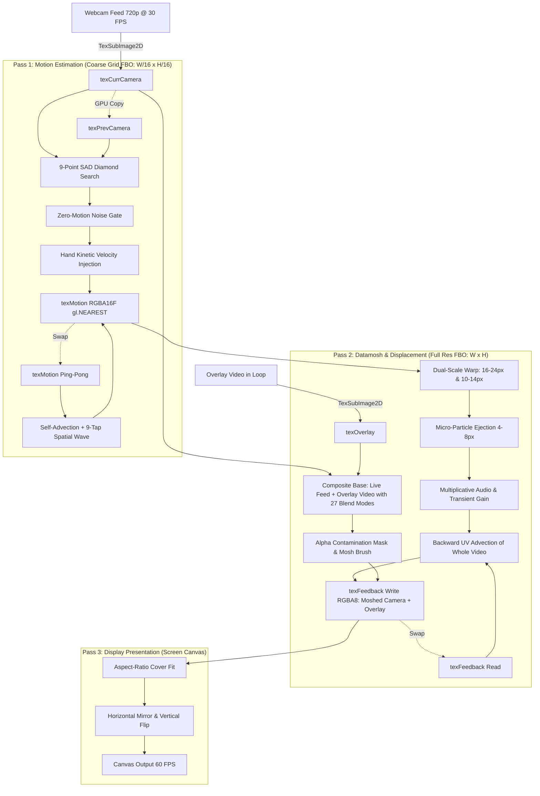

# MOSHROOM — Real-Time Video Deformation

[](https://react.dev/)
[](https://www.typescriptlang.org/)
[](https://vitejs.dev/)
[](https://www.khronos.org/webgl/)
[](https://developers.google.com/mediapipe)
[](https://tailwindcss.com/)

**MOSHROOM** is an experimental real-time video instrument that turns a live camera feed into a continuously deforming, melting, pixel-smearing canvas. It reproduces authentic MPEG-4 / H.264 compression artifacts—specifically **P-frame motion vector displacement** and **I-frame starvation**—using a hardware-accelerated WebGL2 multi-pass GPU pipeline, MediaPipe AI hand tracking, and a Web Audio FFT audio-reactive engine.

---

## Key Features

- **Discrete Block-Matching Motion Estimation (SAD)**: A coarse macroblock grid FBO (`width / 16` × `height / 16`) performs a 9-point diamond search across consecutive webcam frames, minimizing the **Sum of Absolute Differences (SAD)** in Rec. 601 perceptual luminance.
- **Strict `gl.NEAREST` Motion Vector Quantization**: Motion textures sample with `gl.NEAREST` filtering. Every pixel within a macroblock inherits identical motion vectors without bilinear smoothing, producing sharp compression block tears.
- **Zero-Motion Noise Gate**: A cost penalty is applied to non-zero displacements, ensuring sensor grain in stationary or dark backgrounds locks firmly to `(0.0, 0.0)`.
- **Self-Advecting Momentum & Traveling Velocity Waves**: Ping-pong motion FBOs store velocity history. Motion vectors advect backward along themselves and propagate outward through a 9-tap neighborhood sweep, allowing hand swipes to ripple across stationary regions for 20–60 frames.
- **Two-Tier Macroblock & Micro-Particle Scatter**:
  - *Primary Macroblocks* (16px–24px) & *Secondary Sub-Blocks* (10px–14px) adaptively blend on high-contrast edges.
  - *Micro-Particles* (4px–8px) break off on rapid motion with hash-driven speed variation (0.7× to 2.2×) and angular spread ($\pm 18^\circ$).
- **Pure-RGB Color Space & Incoming Saturation Boost**: Saturated live camera input (+50% saturation boost) without recursive feedback color corruption or synthetic chroma tinting.
- **Selective Alpha-Channel Contamination Mask**: Unbrushed regions continue streaming clean 60 FPS live video, while brushed zones freeze and deform into persistent datamosh artifacts.
- **Looping Video Overlay with 27 Photoshop Blend Modes**: Upload external video files (`.mp4`, `.webm`, `.mov`) that loop continuously on top of the live deformation feed, with GPU-accelerated compositing across 6 categories: Normal, Darken, Lighten, Contrast, Comparative, and Composite (HSL) modes, complete with 0–100% opacity control.
- **AI Hand Tracking & Gesture Control**: Built with MediaPipe Tasks Vision (`HandLandmarker`), enabling contact-free performance control.
- **Real-Time FFT Audio-Reactivity**: Multi-band frequency analysis (Bass, Mid, High) and transient kick detection that dynamically surge displacement scale, trigger particle ejections, and boost temporal momentum.
- **Zero-Allocation 60 FPS Render Loop**: DOM refs, canvas 2D meters, and direct WebGL uniforms eliminate React re-renders during active tracking and rendering.

---

## Gesture Control System

MOSHROOM features a dual-hand computer vision controller powered by **MediaPipe Tasks Vision** running WASM + GPU delegates (with CPU fallback). Inference is throttled to ~15 Hz with 60 FPS linear interpolation for fluid interaction.

```
       LEFT HAND: AUDIO & REACTIVITY            RIGHT HAND: MOSH BRUSH
     ┌─────────────────────────────────┐     ┌─────────────────────────────────┐
     │  OPEN:  Play Track + Reactivity │     │  OPEN:  Active Mosh Brush       │
     │  FIST:  Pause Audio (Debounced) │     │  FIST:  Lock / Freeze Canvas    │
     │  ELEVATE: Amplify Audio Gain    │     │  PINCH: Adjust Brush Diameter   │
     └─────────────────────────────────┘     └─────────────────────────────────┘
                       ▲                                      ▲
                       └─────────── DUAL FIST ────────────────┘
                                   (> 250ms)
                            CLEAN I-FRAME RESET
```

### 1. Right Hand — Mosh Brush & Velocity Injection
- **Open Hand**: Activates the datamosh brush. Tracks palm UV coordinates and injects kinetic hand velocity directly into the motion field. Thumb-to-index pinch distance dynamically scales the brush radius.
- **Closed Fist**: Instantly freezes the brush and permanently locks smeared macroblock artifacts in place.

### 2. Left Hand — Audio Playback & Reactivity Controller
- **Open Hand**: Starts audio playback. Raising your hand vertically (0.0 to 1.0 UV height) scales the audio reactivity gain from 0.3× to 2.0× and drives live mosh intensity.
- **Closed Fist**: Pauses audio playback (with 200ms debounce to prevent tracking jitter).

### 3. Dual-Hand Gesture — I-Frame Reset
- **Double Fist**: Closing both hands into fists simultaneously for >250ms triggers an immediate clean **I-Frame Reset**, clearing feedback FBOs back to pristine live video.

---

## Audio-Reactive Engine

MOSHROOM includes a built-in Web Audio API analyzer (`AudioAnalyzer`) that modulates deformation physics in real time:

- **Supported Formats**: `.mp3`, `.wav`, `.ogg`, `.m4a`, `.flac` with seamless loop toggling.
- **Multi-Band FFT Analysis** (1024 FFT size, 0.75 smoothing time constant):
  - **Bass** (~20–150 Hz): Low-frequency power curve ($raw^{1.4}$) drives P-frame bloom and scales vector momentum up to 0.975.
  - **Mid** (~200–2000 Hz): Modulates perpendicular edge smear and color cross-contamination.
  - **High** (~2500–10000 Hz): Punches high-contrast facial and contour features through the melt via edge breakthrough masks.
  - **Transient Onset / Beat Detector**: Fast-attack, exponential-decay (~0.88/frame) delta tracker against exponential moving average bass energy. Kicks and snare hits trigger instantaneous 1.5× to 3.0× displacement surges and micro-particle scatter bursts.
- **Zero Drift Floor**: Multiplicative audio scaling ensures stationary backgrounds stay completely still ($0.0 \times \text{audio} = 0.0$).
- **Real-Time Visualizer**: 60 FPS monochromatic 3-bar level meter (Bass / Mid / High) with transient kick flash highlights.

---

## Video Overlay & Blend Modes

Users can add an external video file (`.mp4`, `.webm`, `.mov`, `.m4v`, `.mkv`) that layers directly on top of the live deformation canvas. The overlay plays in a seamless loop (or with manual playback/loop toggles) and features GPU-accelerated compositing with an opacity slider (0–100%) and all 27 standard Photoshop blend modes:

| Category | Blend Modes | Description / Formula |
|:---|:---|:---|
| **Normal** | `Normal`, `Dissolve` | Standard overlay or dithered opacity hash |
| **Darken** | `Darken`, `Multiply`, `Color Burn`, `Linear Burn`, `Darker Color` | Retains darker luminance tones, darkening base pixel data |
| **Lighten** | `Lighten`, `Screen`, `Color Dodge`, `Linear Dodge (Add)`, `Lighter Color` | Drops blacks, amplifying brightness and luminous trails |
| **Contrast** | `Overlay`, `Soft Light`, `Hard Light`, `Vivid Light`, `Linear Light`, `Pin Light`, `Hard Mix` | Increases dynamic range; highlights lighten and shadows darken |
| **Comparative** | `Difference`, `Exclusion`, `Subtract`, `Divide` | Inverts and subtracts color channels to reveal motion deltas |
| **Composite** | `Hue`, `Saturation`, `Color`, `Luminosity` | Combines HSL color attributes between camera and video |

---

## GPU Pipeline Architecture

The rendering pipeline executes in WebGL2 across three primary passes using a single-triangle fullscreen quad (`gl_VertexID`):



### Shader Breakdown

1. **`VERTEX_SHADER`**: Generates clip-space coordinates $(-1 \to 3)$ from vertex IDs $0, 1, 2$ without vertex buffer overhead.
2. **`MOTION_ESTIMATION_FRAGMENT_SHADER`**:
   - Computes local Rec. 601 luminance: $Y = 0.299R + 0.587G + 0.114B$.
   - Performs a 9-point diamond neighborhood search with zero-motion cost biasing.
   - Applies noise-floor gating against camera sensor jitter.
   - Integrates hand velocity and propagates velocity waves backward along motion vectors.
3. **`DATAMOSH_FRAGMENT_SHADER`**:
   - Blends the live camera input with the looping video overlay using the chosen Photoshop blend mode and opacity to produce a unified composite base frame.
   - Applies the **Mosh Brush** directly to this combined stream so hand gestures smear and tear both the camera feed and the overlay video simultaneously.
   - Computes organic macroblock warping along subject contours.
   - Dual-scale macroblock sampling based on local luminance edge contrast.
   - Micro-particle hashing with pseudo-random speed and angular scatter across both camera and overlay pixels.
   - Modulates displacement scale by bass and transient audio energy.
4. **`DISPLAY_FRAGMENT_SHADER`**:
   - Hardware aspect-ratio compensation (`object-fit: cover`) preventing distortion.
   - Real-time horizontal selfie mirror and vertical inversion toggles.

---

## Parameter Dynamics

MOSHROOM derives all macroblock, momentum, and feedback parameters from the **Particle Displacement** control and dynamic vision/audio inputs:

| Range / Control | Bypass | Macroblock Size | Vector Momentum | Feedback Retention | Decay / Healing | Visual Behavior |
|:---|:---:|:---:|:---:|:---:|:---:|:---|
| **0 (Bypass)** | `true` | 12 px | 0.00 | 0% | 0.05 | Immediate I-frame reset to 100% clean live video. |
| **1 – 24 (Healing)** | `false` | 12 px | 0.10 – 0.35 | 50% – 90% | 0.003 – 0.038 | Gradual recovery range. Smeared trails gently decay back to live webcam. |
| **25 – 100 (Freeze)** | `false` | 12 – 24 px | 0.35 – 0.93 | 100% | **0.00 (Zero)** | **True I-frame starvation**. Smeared pixels freeze permanently until swept by new motion or restored. |
| **Particle Disp (0–100)** | — | — | — | — | — | Non-linear exponential curve ($\text{norm}^{1.6}$) scaling fling distance from subtle jitter to full-screen tears. |
| **Audio Modulation** | — | +0 to +8 px | +0.0 to +0.24 | — | — | Heavy kicks trigger 1.5× to 3.0× displacement surges and transient particle bursts. |

---

## Technology Stack

- **Framework**: [React 19](https://react.dev/) + [TypeScript 6](https://www.typescriptlang.org/)
- **Bundler & Tooling**: [Vite 8](https://vitejs.dev/) + [@vitejs/plugin-react](https://github.com/vitejs/vite-plugin-react)
- **Styling**: [Tailwind CSS v4](https://tailwindcss.com/) (Brutalist, monospace dark-mode aesthetic)
- **Graphics Pipeline**: WebGL2 (`#version 300 es`), Floating-Point Textures (`EXT_color_buffer_float`), Multi-Pass FBO Ping-Ponging
- **Vision Engine**: [@mediapipe/tasks-vision](https://developers.google.com/mediapipe/solutions/vision/hand_landmarker) (HandLandmarker WASM + GPU delegate)
- **Audio Analysis**: Web Audio API (`AudioContext`, `AnalyserNode` with FFT bin categorization)
- **Icons**: [Lucide React](https://lucide.dev/)
- **Linter & Tests**: [Oxlint](https://oxc.rs/) + Node.js Native Test Runner (`node:test`, `node:assert/strict`)

---

## Getting Started

### Prerequisites
- Node.js (v20+ recommended)
- Modern web browser with **WebGL2** support (Chrome, Edge, Firefox, Safari 15+)
- Web camera and microphone/audio output

### Installation
```bash
# Clone repository
git clone https://github.com/YOUR_USERNAME/moshroom.git
cd moshroom

# Install dependencies
npm install
```

### Development Server
```bash
npm run dev
```
Open `http://localhost:5173` in your browser and grant camera access when prompted.

### Production Build
```bash
# Type check and build bundle
npm run build

# Preview production build locally
npm run preview
```

### Testing & Quality
```bash
# Run unit test suite (20 tests covering parameters, GLSL shaders, audio physics)
npm test

# Run Oxlint
npm run lint
```

---

## Project Structure

```
MOSHROOM/
├── public/                 # Static assets & SVG icons
├── src/
│   ├── assets/             # Brand logos & preview graphics
│   ├── components/         # High-performance React UI components
│   │   ├── AudioControl.tsx       # Audio upload, playback, loop & 2D FFT level meter
│   │   ├── CameraPreview.tsx      # WebGL canvas viewport, gesture HUD & DOM reticles
│   │   ├── MoshControl.tsx        # Particle displacement slider & live intensity meter
│   │   └── VideoOverlayControl.tsx # Video overlay upload, loop, opacity & blend modes
│   ├── hooks/
│   │   └── useCamera.ts           # Camera lifecycle, permissions, and stream constraints
│   ├── lib/
│   │   ├── audio/
│   │   │   └── AudioAnalyzer.ts   # Web Audio FFT analysis & transient onset detection
│   │   ├── datamosh/
│   │   │   ├── blendModes.ts       # 27 Photoshop blend mode definitions & categories
│   │   │   ├── DatamoshRenderer.ts # WebGL2 multi-pass orchestration & ping-pong FBOs
│   │   │   ├── parameters.ts       # Non-linear parameter derivation & audio modulation
│   │   │   └── shaders.ts          # GLSL ES 3.00 shader programs (Motion, Mosh, Display)
│   │   └── vision/
│   │       └── HandTracker.ts      # MediaPipe HandLandmarker wrapper & gesture heuristic
│   ├── App.tsx             # Application layout & imperative ref bindings
│   ├── index.css           # Tailwind CSS imports & base styles
│   └── main.tsx            # React application entry point
├── test/
│   └── mosh.test.ts        # Comprehensive unit tests for physics & shaders
├── package.json
├── tsconfig.json
└── vite.config.ts
```

---

## Browser & Hardware Requirements

- **WebGL2 Support**: Required for `#version 300 es` shaders, multiple render targets, and 32-bit/16-bit floating-point textures (`EXT_color_buffer_float`).
- **Camera Access**: Camera permissions must be granted in the browser.
- **Hardware Acceleration**: A dedicated or modern integrated GPU is strongly recommended for consistent 60 FPS performance at 720p.

---

## License

MIT License. Designed and engineered for real-time audiovisual performance.
